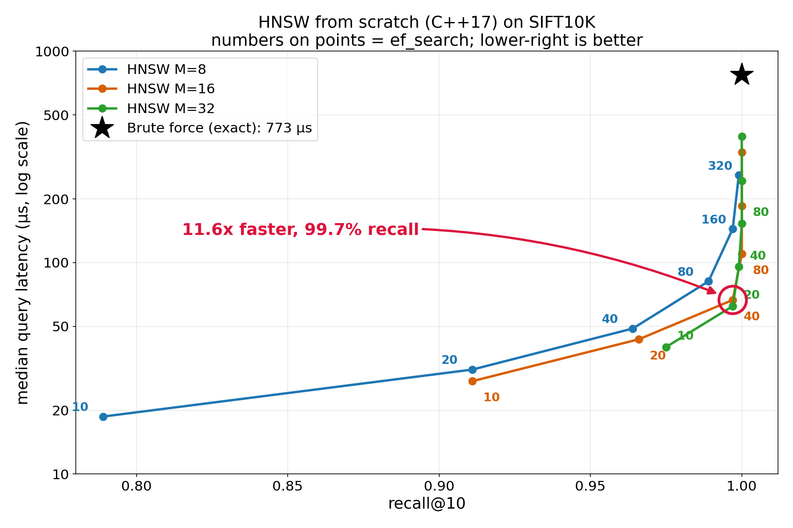

# VecLite

An in-memory approximate nearest neighbour (ANN) search library in C++17, built from scratch around **HNSW** (the algorithm behind pgvector, FAISS and Pinecone's graph indexes). Includes an exact brute-force baseline, a benchmark harness and a recall-vs-latency plot.

On SIFT10K (10,000 x 128-d vectors), single thread:

| | Recall@10 | Median latency | vs brute force |
|---|---|---|---|
| Brute force (exact) | 100% | 773 us | 1x |
| HNSW `M=16, ef_search=40` | **99.7%** | **66.6 us** | **11.6x faster** |
| HNSW `M=16, ef_search=10` | 91.1% | 27.5 us | 28x faster |



## What HNSW is

- Every vector is a node in a graph linked to nearby vectors; search hops greedily toward the query.
- The graph is layered like a skip list: a few nodes on the top layers give long jumps, and every node lives on layer 0 for the fine search.
- One knob, `ef_search`, trades accuracy for speed: it is the number of candidates the search keeps alive.

```
layer 2:   o-----------------------o            few nodes, long jumps
layer 1:   o-------o-------o-------o------o     more nodes
layer 0:   o-o-o-o-o-o-o-o-o-o-o-o-o-o-o-o-o    every node, short links
           query enters at the top, drops a layer each time it stops improving
```

## Build and reproduce (~5 minutes, mostly the dataset download)

Requirements: a C++17 compiler, CMake >= 3.16, Ninja (or any generator), Python 3 with matplotlib (only for plots). `doctest` is vendored in `third_party/`.

```bash
# 1. dataset: SIFT10K / "siftsmall" (~5 MB, TEXMEX corpus)
mkdir -p data && cd data
curl -C - -O ftp://ftp.irisa.fr/local/texmex/corpus/siftsmall.tar.gz   # FTP can be slow (~3 min); -C - resumes a cut-off download
tar -xzf siftsmall.tar.gz && cd ..

# 2. build (Release by default: -O3 -march=native) and test
cmake -S . -B build -G Ninja
cmake --build build
./build/tests                         # 15 test cases; the SIFT test is skipped if data/ is missing

# 3. benchmark (3 runs, per-row median) and chart
./build/bench data/siftsmall/siftsmall_ run1.csv
./build/bench data/siftsmall/siftsmall_ run2.csv
./build/bench data/siftsmall/siftsmall_ run3.csv
python scripts/aggregate.py results.csv run1.csv run2.csv run3.csv
python scripts/plot.py results.csv recall_vs_latency.png      # 1800x1200 PNG
```

On Windows (MSYS2 UCRT64) run `build\tests.exe` and `build\bench.exe` instead. Always benchmark a Release build; Debug numbers are 10-50x slower.

## Layout

```
include/veclite/  distance.hpp  brute_force.hpp  flat_graph.hpp (phase-2 experiment)
                  hnsw.hpp  io.hpp  visited.hpp  recall.hpp  random.hpp
src/              hnsw.cpp  io.cpp
bench/            bench.cpp (main benchmark)  bench_random.cpp (brute force on random data)
                  flat_demo.cpp (single-layer experiment)
tests/            doctest suites
scripts/          plot.py  aggregate.py
```

## Results (SIFT10K, `ef_construction=200`)

Machine: AMD Ryzen 5 5500U (laptop), Windows 11, g++ 13.1 (MSYS2 UCRT64), `-O3 -march=native`, single thread (pinned to one core, high priority). Full data in `results.csv`; the full 18-row sweep, build costs and test notes are in `RESULTS.md`.

### Method

Each configuration is timed with 15 repeats per query, interleaved across the query set (so a repeat never hits a warm cache from the previous repeat of the same query), after a warm-up pass. Per-query latency = median of its 15 repeats; the reported median and p99 are across the 100 queries. The whole benchmark was run 3 times and `results.csv` holds the per-row median of those runs (`scripts/aggregate.py`). Recall is deterministic (identical across runs); latency varied by <=8% between runs for most rows and up to ~23% for a few. Chart: `recall_vs_latency.png`.

Subset of the sweep:

| M | ef_search | recall@1 | recall@10 | median us | p99 us | speedup |
|---|---|---|---|---|---|---|
| 8 | 10 | 0.820 | 0.789 | 18.7 | 33.0 | 41.3x |
| 8 | 40 | 0.980 | 0.964 | 48.8 | 76.8 | 15.8x |
| 8 | 160 | 1.000 | 0.997 | 144.5 | 199.8 | 5.3x |
| 16 | 10 | 0.960 | 0.911 | 27.5 | 43.9 | 28.1x |
| 16 | 40 | 1.000 | 0.997 | 66.6 | 98.8 | 11.6x |
| 16 | 160 | 1.000 | 1.000 | 185.8 | 264.4 | 4.2x |
| 32 | 10 | 0.990 | 0.975 | 39.9 | 66.8 | 19.4x |
| 32 | 20 | 1.000 | 0.997 | 62.3 | 93.2 | 12.4x |
| 32 | 160 | 1.000 | 1.000 | 243.6 | 354.8 | 3.2x |

Build time: 1.48 s (M=8), 1.89 s (M=16), 2.94 s (M=32). Memory (vectors + links): 5.66 / 6.15 / 7.14 MB.

## What I learned

- **Benchmark method moves the numbers.** My first method (back-to-back repeats of each query) reported HNSW ~1.4x faster than interleaved repeats, likely from cache warmth; I publish the stricter number.
- **Recall@1 saturates long before recall@10.** The nearest neighbour is found at `ef=40`, while the 10th needs far more exploration.
- **M=16 vs M=32 reach the same recall at the same latency** (99.7% at ~62-67 us), but M=32 builds 1.6x slower and uses more memory. **M=8 needs ~2x the latency** for that recall. Past a point, more links just add distance computations.
- **Speedup is a dial, not a number.** The same index gives 41x or 2.0x depending on `ef_search`, so always quote speedup together with recall.
- A single flat graph with a fixed entry point reached only 40% recall@10 at `ef=10` (87% at `ef=100`). The hierarchy gives the search a good starting point, which is where the early win comes from.

## Audit and fixes

Checks run: strict warnings (`-Wall -Wextra -Wpedantic -Wshadow -Wconversion`), bounds-checked STL build of the full test suite (`-D_GLIBCXX_ASSERTIONS -D_GLIBCXX_DEBUG`, no errors; ASan/UBSan are not available on this MinGW toolchain), and a repeat-run reproducibility check of the benchmark.

| Finding | Fix |
|---|---|
| Latency varied up to 86% between two identical bench runs; recall was identical | Interleaved 15 repeats, high priority, pinned core, 3 runs aggregated by median (`scripts/aggregate.py`) |
| Old numbers were ~1.4x optimistic for HNSW (likely cache warmth) | All tables, chart, README regenerated with the stricter method |
| `M < 2` gave an infinite level multiplier (`1/ln(1)`) | `Hnsw` constructor throws `std::invalid_argument` for `M < 2`, `ef_construction < M`, `dim == 0` |
| Inner-product / cosine path was untested | New test: normalised vectors + `Metric::InnerProduct`, recall > 0.9 |
| No tests for empty index, `k > N`, `ef < k`, duplicate vectors, level distribution | Added in `tests/test_edge_cases.cpp` (6 new cases, 15 total) |
| Phase-1 random-data brute-force benchmark was lost when `bench.cpp` was rewritten | Restored as `bench/bench_random.cpp` |
| Missing `<algorithm>` in `visited.hpp`; `-Wconversion` warning in `recall.hpp` | Fixed |
| No way to pre-allocate | Added `Hnsw::reserve(n)` (used by the benchmark) |

## Suggested upgrades (not done yet)

| Upgrade | Why |
|---|---|
| AVX2/FMA distance with several accumulators | GCC only partly vectorises the in-order float reduction; distance is the hot loop |
| Heuristic neighbour selection (paper Algorithm 4) | Better recall per link, fewer unreachable nodes; the code already isolates `select_neighbors()` |
| Flat, fixed-stride layer-0 link storage + prefetch | Removes `vector<vector<vector>>` pointer chasing; most of the per-query cache misses |
| SIFT1M benchmark, more queries | SIFT10K saturates at 100% recall and has only 100 queries |
| Compare against `hnswlib` | Shows how far a from-scratch version is from production |

## Caveats and limitations

- SIFT10K is easy and has only 100 queries, so recall saturates at 100% quickly and p99 is noisy.
- Single laptop, single thread; numbers will vary on other machines.
- Simple neighbour selection (M closest); distance code is plain scalar C++ (GCC auto-vectorises only part of it, no explicit SIMD).
- Single-threaded, not thread-safe, no deletes, no persistence. Per-node `vector<vector<>>` link storage, so memory figures count only floats and link ids, not allocator overhead.

## References

Malkov & Yashunin, *Efficient and robust approximate nearest neighbor search using Hierarchical Navigable Small World graphs* (2016/2018).
